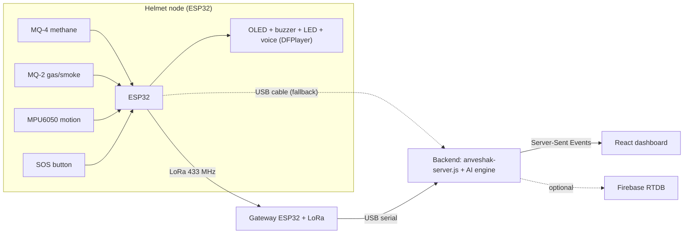

# ANVESHAK — AI-Powered Smart Helmet for Underground Mine Safety

[](https://opensource.org/licenses/MIT)
[](https://react.dev/)
[](https://nodejs.org/)
[](https://espressif.com/)

**ANVESHAK** (Sanskrit for *"explorer / investigator"*) is a wearable smart helmet for underground miners. It detects gas, falls and SOS on the helmet itself, warns the miner instantly, and sends alerts to the rescue team over **LoRa radio — no mobile network or internet needed underground**. On the rescue team's laptop, an **AI risk engine** predicts rising gas danger and ranks each miner by risk, so rescuers know who to reach first.

Built by **Team Project X** (Vivekananda Global University) for the problem statement *"AI-Powered Underground Mine Safety, Monitoring and Rescue System"* (theme: Smart Automation).

---

## Problem

Underground miners face gas leaks, falls and roof collapses, and with no network underground, rescue teams often learn too late. In 2024, Indian coal mines recorded **38 fatal accidents** (DGMS Annual Report 2024, provisional). Fixed gas monitors don't move with the miner, simple wearable alarms only warn the person wearing them, and radio links fail through rock.

## Solution

| Layer | What it does |
| --- | --- |
| **Helmet node (ESP32)** | MQ-4 (methane) and MQ-2 (smoke / combustible gas) sensing, MPU6050 fall detection, SOS button, OLED, buzzer, LED and voice alerts (DFPlayer). All local alerts work **without** the laptop. |
| **LoRa link (433 MHz)** | The helmet sends a compact packet every second, and immediately on any alert, to a LoRa gateway. |
| **Gateway (ESP32 #2)** | Receives LoRa packets, adds signal strength (RSSI/SNR) and forwards them to the laptop over USB. |
| **Backend (`backend/anveshak-server.js`)** | Reads the gateway, runs the **AI risk engine**, streams live data to the dashboard (Server-Sent Events), optional Firebase sync. |
| **Dashboard (React)** | Live sensors, AI risk panel, alerts and SOS, history with CSV export, link health. |

---

## System Architecture



---

## AI Risk Engine (`backend/ai-engine.js`)

Runs on every packet:

1. **Gas trend prediction** — fits a straight line (linear regression) to the last 60 s of gas readings and predicts the **time until the danger level**, e.g. *"Danger level predicted in ~4 min"*.
2. **Gas anomaly detection** — flags **sudden spikes** far above the recent average (z-score), even below the danger threshold.
3. **Fall confidence** — the helmet confirms falls itself (free fall → impact → lying still + tilted). The engine scores how strongly each impact matches a real fall using the features the helmet sends (peak g, free-fall minimum, tilt, stillness).
4. **Explainable miner risk score (0–100)** — gas level (up to 40), gas trend/spike (up to 15), fall (30), no movement after a fall (20) or for a long time (10). **SOS sets the score to 100.** Every point comes with a reason shown on the dashboard.

Test it without hardware:

```bash
cd backend
npm install
npm run test:ai
```

**Planned:** a trained ML fall classifier (Random Forest on recorded MPU6050 data: falls vs sitting, bending, walking, dropping the helmet), compared against the current rule-based detection.

---

## Hardware

### Bill of materials (per helmet + one gateway)

| Component | Purpose |
| --- | --- |
| ESP32 DevKit V1 × 2 | Helmet controller + gateway |
| LoRa Ra-02 (SX1278, 433 MHz) × 2 + 433 MHz antennas | Wireless link without internet |
| MQ-4 gas sensor | Methane (main explosive gas in coal mines) |
| MQ-2 gas sensor | Smoke / LPG / combustible gases |
| MPU6050 | Fall and movement detection |
| 0.96" SSD1306 OLED | Status on the helmet |
| DFPlayer Mini + small 8 Ω speaker + microSD | Voice alerts |
| Buzzer, red LED, push button | Audible / visible alerts, SOS |
| 18650 cell, TP4056 (with protection), MT3608 boost (5 V) | Battery power |

### Helmet pin map

| Module | Module pin | ESP32 pin | Power | Notes |
| --- | --- | --- | --- | --- |
| MQ-2 | AO | GPIO 34 | 5 V | Through 10 kΩ/10 kΩ divider (AO → 10k → GPIO → 10k → GND) |
| MQ-4 | AO | GPIO 35 | 5 V | Same divider |
| MPU6050 | SDA / SCL | GPIO 21 / 22 | 3.3 V | I²C 0x68 |
| OLED | SDA / SCL | GPIO 21 / 22 | 3.3 V | I²C 0x3C (shared bus) |
| LoRa Ra-02 | SCK / MISO / MOSI | GPIO 18 / 19 / 23 | **3.3 V only** | Antenna attached before power-on |
| LoRa Ra-02 | NSS / RST / DIO0 | GPIO 5 / 14 / 26 | | |
| DFPlayer | RX / TX | GPIO 17 (via 1 kΩ) / GPIO 16 | 5 V | Speaker on SPK1 / SPK2 |
| SOS button | one leg | GPIO 4 | | Other leg to GND (INPUT_PULLUP) |
| Buzzer | + | GPIO 25 | | |
| Alert LED | anode | GPIO 32 (via 220 Ω) | | |

The **gateway** uses the same LoRa pins (and an optional OLED on GPIO 21/22) and is powered by the laptop's USB.

### LoRa packet format

```
ANV,device,loraSeq,status,sos,fall,mq2Adc,mq2Ppm,mq4Adc,mq4Ppm,ax,ay,az,gx,gy,gz,devTemp,roll,pitch,impactId,peakG,minG,peakGyro,tilt,still
```

The gateway forwards it as `[ANVESHAK_LORA]<packet>|<RSSI>|<SNR>`. The dashboard uses the LoRa sequence number to show packet loss.

---

## Setup

### 1. Helmet firmware — `hardware/anveshak_esp32_firmware/`

1. Arduino IDE 2.x with the **ESP32 board package** (Espressif). Board: **ESP32 Dev Module**.
2. Libraries: `Adafruit SSD1306`, `Adafruit GFX Library`, `LoRa` (Sandeep Mistry), `DFRobotDFPlayerMini`. (`Blynk` only if you enable it.)
3. Feature switches at the top of the sketch: `USE_MQ4`, `USE_DFPLAYER`, `USE_WIFI_HTTP` (off by default), `USE_BLYNK` (off), `CALIBRATION_MODE`.
4. **Gas calibration:** set `CALIBRATION_MODE 1`, upload, keep the helmet in clean air for 20+ minutes, copy the printed `MQ2_R0` and `MQ4_R0` values into the sketch, set `CALIBRATION_MODE 0` and upload again. Until then, raw ADC thresholds are used.
5. **Voice files:** microSD (FAT32) with a folder `mp3` containing `0001.mp3` (gas warning), `0002.mp3` (gas danger — evacuate), `0003.mp3` (fall detected), `0004.mp3` (SOS sent), `0005.mp3` (alert cleared).

**Button:** short press = SOS. Hold 2 s = cancel SOS / fall ("I'm OK").

### 2. Gateway firmware — `hardware/anveshak_gateway/`

Upload to the second ESP32 and connect it to the laptop by USB. It prints `[GATEWAY] Ready` and then one line per packet received.

### 3. Backend — `backend/anveshak-server.js`

```bash
cd backend
npm install
cp .env.example .env      # Windows: copy .env.example .env
# set SERIAL_PORT=COM14 (Windows) or /dev/ttyUSB0 (Linux), or leave empty to auto-detect
npm start
```

The backend runs on `http://localhost:5000` (`/api/stream`, `/api/latest`, `/api/history`, `POST /api/ingest`, `/health`). Firebase sync is optional and stays off unless configured in `.env`.

**No LoRa? Use the cable:** plug the helmet into the laptop instead of the gateway. The helmet also prints its full data as `[ANVESHAK_DATA]{json}` on USB, so the dashboard works the same way.

### 4. Dashboard

```bash
npm install
npm run dev
```

Open `http://localhost:5173`.

---

## Project Status

**Working on hardware:** MQ-2 gas sensing, MPU6050 motion sensing, OLED display, buzzer alarm, live dashboard over USB.

**Implemented in code, being tested on hardware:** SOS button, on-helmet fall detection (50 Hz), MQ-4 methane sensing with calibration, DFPlayer voice alerts, LoRa gateway link with RSSI / packet loss, AI risk engine and dashboard AI panel.

**Planned:** trained ML fall classifier, UWB location (UWB tags on helmets + anchors in the tunnel to show each worker's exact position), ambient temperature/humidity sensor (BME280), LoRa relay nodes for long tunnels, mine-map safe-route planning.

> The temperature shown is the **MPU6050 chip temperature**, not the air around the miner.

---

## Repository Structure

```
ANVESHAK/
├── hardware/
│   ├── anveshak_esp32_firmware/   # helmet node firmware
│   └── anveshak_gateway/          # LoRa receiver gateway firmware
├── backend/
│   ├── anveshak-server.js         # backend server (serial / HTTP ingestion, SSE stream)
│   ├── ai-engine.js               # AI risk engine
│   ├── lora-parser.js             # LoRa gateway line parser
│   ├── test-ai.js                 # AI engine test without hardware
│   └── cloudFunction.js           # optional Firebase Cloud Function ingestion
├── src/                           # React dashboard
│   └── components/visualizers/AiRiskPanel.jsx
└── README.md
```

---

## Team Project X (Vivekananda Global University)

| Member | NIAT ID | Role |
| --- | --- | --- |
| **Jatin Chandolia** (Team Leader) | N25J01A0094 | Hardware: circuit, sensors, LoRa, wiring and helmet build |
| **Mohd Uvais** | N25J01A0374 | Frontend: live dashboard, alerts and AI risk display |
| **Sahil Tilani** | N25J01A0352 | Presentation, documentation and testing support |

---

## Safety Disclaimer

> **ANVESHAK is a student prototype.** It is not a certified life-safety device and has not been evaluated under ATEX, IECEx or mining safety standards. The MQ-series sensors are low-cost and need calibration against reference instruments. Do not use it as a primary safety device in real hazardous environments.

## License

MIT — see [LICENSE](./LICENSE).
