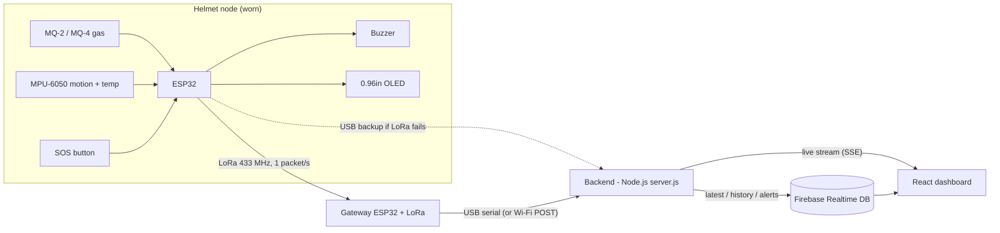

# ANVESHAK — Smart Safety Helmet with LoRa Monitoring

[](https://opensource.org/licenses/MIT)
[](https://react.dev/)
[](https://nodejs.org/)
[](https://espressif.com/)

**ANVESHAK** (Sanskrit for *"explorer"*) is a wearable safety helmet for workers in mines, factories, sewers and disaster sites. It detects **gas leaks, falls and emergencies (SOS)** and warns the worker on the helmet itself. It also sends live data over **LoRa** to a gateway, so a supervisor can watch every reading and every alert on a web dashboard, along with a **72-hour history**.

---

## 1. Problem

Workers in hazardous places face:

- **Toxic or flammable gas** (LPG, methane, smoke) that they can't see or smell in time.
- **Falls and impacts** where the injured worker can't call for help.
- **No Wi-Fi or mobile network** underground or inside large structures.

Fixed gas detectors don't move with the worker. Personal alarms only beep locally, so nobody outside knows something is wrong.

## 2. Our solution

| Layer | What it does |
|---|---|
| **Helmet node** | Reads the gas sensor, motion sensor and SOS button. It **beeps and shows the alarm on its own OLED** with no network needed, and sends a packet every second over LoRa. |
| **LoRa gateway** | Receives the helmet's packets over long range with no Wi-Fi or SIM, and forwards them to the laptop over USB (or Wi-Fi). |
| **Backend** | Checks each packet, adds the official timestamp, saves the live value, history and alerts to Firebase, and streams them to the dashboard. |
| **Dashboard** | Shows live readings, alerts with acknowledge buttons, a 3D view of the helmet's tilt, a copy of the helmet's OLED screen, and history up to 72 h+ with CSV export. |

## 3. System architecture



**Safety first:** the alarm decision is made **on the helmet**, so the buzzer still sounds if LoRa, Wi-Fi, the laptop or the internet goes down.

---

## 4. Hardware

### Bill of materials

| Qty | Part | Used for |
|---|---|---|
| 2 | ESP32 dev board (ESP32-WROOM-32) | One in the helmet, one as the gateway |
| 2 | SX1278 LoRa module (Ra-02, 433 MHz) | Helmet-to-gateway radio link |
| 2 | Antenna, or a **17.3 cm wire** (433 MHz quarter wave) | **Required.** Never transmit without one. |
| 1 | MQ-2 (smoke/LPG) or MQ-4 (methane) gas sensor | Gas detection |
| 1 | MPU-6050 accelerometer + gyroscope | Fall/impact detection, tilt, temperature |
| 1 | SSD1306 0.96" I2C OLED (128×64) | Display on the helmet |
| 1 | Buzzer | Local alarm |
| 1 | Push button | SOS |
| 2 | Resistors 10 kΩ + 20 kΩ | Voltage divider for the gas sensor output |
| 1 | Power bank / Li-ion with 5 V output | Helmet power |

The gateway can also be an **Arduino Uno** (USB only, needs 3.3 V level shifting for LoRa). See [`hardware/README.md`](./hardware/README.md).

### Helmet wiring (ESP32)

| Part | Pin → ESP32 |
|---|---|
| MQ-2 / MQ-4 | VCC→5V (VIN), GND→GND, **AO → 10 kΩ → GPIO34**, GPIO34 → 20 kΩ → GND (keeps the signal under 3.3 V) |
| MPU-6050 | VCC→3V3, GND→GND, SDA→GPIO21, SCL→GPIO22 (address 0x68) |
| OLED SSD1306 | VCC→3V3, GND→GND, SDA→GPIO21, SCL→GPIO22 (address 0x3C, same I2C bus) |
| Buzzer | + → GPIO25, − → GND |
| SOS button | GPIO4 ↔ GND (internal pull-up) |
| LoRa Ra-02 | 3V3, GND, SCK→18, MISO→19, MOSI→23, NSS→5, RST→14, DIO0→26 |

### Gateway wiring (ESP32)

The LoRa module uses the same pins as the helmet: SCK 18, MISO 19, MOSI 23, NSS 5, RST 14, DIO0 26. The gateway connects to the laptop by USB.

---

## 5. How detection works

| Event | How the helmet detects it | Helmet reaction | Dashboard |
|---|---|---|---|
| **Gas warning** | Reading ≥ clean-air baseline **+ 400** ADC | Short beep every second, OLED shows `WARN` | Yellow alert |
| **Gas danger** | Reading ≥ baseline **+ 900** ADC | Fast siren, OLED shows `DANGER` | Red alert |
| **Fall / impact** | Total acceleration ≥ **2.5 g** (sampled 50 times a second) | Fast siren for 10 s, OLED shows `FALL!` | Red alert |
| **SOS** | Button pressed (**hold 3 s to cancel**) | Fast siren, OLED shows `SOS ON` | Red alert |

**Gas sensor without calibration:** MQ sensors need lab calibration to report true ppm, and we don't claim ppm values. Instead the helmet warms up for **2 minutes** (OLED shows `WARMUP`), saves the **clean-air reading as its baseline**, and alarms on how far the reading rises above it. The offsets are `GAS_WARN_DELTA` and `GAS_DANGER_DELTA` in the firmware. The dashboard uses the **same alarm level the helmet sends**, so the buzzer and the dashboard never disagree.

**Temperature** is the MPU-6050's chip temperature. It runs a few °C above the air temperature.

### LoRa packet format

Plain text with integers only, so it also works on 8-bit Arduino boards. It is about 60 bytes, sent once per second:

```
AV1,<seq>,<gasAdc>,<baseline>,<gasAlarm 0/1/2>,<ax mg>,<ay mg>,<az mg>,<gx 0.1dps>,<gy 0.1dps>,<gz 0.1dps>,<temp 0.1C>,<sos>,<fall>,<mpuOk>
```

The gateway rejects any packet that doesn't match this exact format. Both radios use the private sync word `0xA5`, so other LoRa devices nearby are ignored.

---

## 6. Data and database (Firebase Realtime Database)

```
devices/ANVESHAK-ESP32-01/
  latest          live packet, overwritten every second
  history/{id}    one row every 15 s, or immediately on any alarm
  alerts/{id}     one record when an SOS, fall or gas alarm STARTS
```

The backend applies these rules so the stored data stays accurate:

- **Server time is the official timestamp.** The helmet has no real-time clock.
- **Duplicate packets are dropped** using the packet sequence number.
- **Missing readings are stored as empty, never as 0**, so a sensor failure doesn't look like a real reading.
- **Each history row keeps the highest gas and g-force value** from its 15-second window, so short spikes are never lost.
- 72 h of history is about 17,000 rows. The dashboard downloads only the selected time range, using the `timestamp` index in [`database.rules.json`](./database.rules.json).

---

## 7. Dashboard pages

| Page | Shows |
|---|---|
| **Live Monitoring** | Live gas level, acceleration and rotation, temperature, 3D tilt cube, copy of the OLED screen, device online/offline (offline after 15 s with no data) |
| **Alerts & SOS** | All alerts with severity and time. Acknowledge one or all. |
| **History** | 1 h / 6 h / 24 h / **72 h** / 7 days / custom range, charts for each sensor, summary stats, table, **CSV export** |
| **Settings** | Firebase connection and alert thresholds |

---

## 8. Running the project

### Requirements
- Node.js 18 or newer
- Arduino IDE 2.x with **ESP32 board support**
- Arduino libraries: **LoRa** (Sandeep Mistry) and **U8g2** (olikraus)
- A Firebase project with Realtime Database and Authentication enabled

### Step 1: Flash the boards
1. Open [`hardware/helmet_node/helmet_node.ino`](./hardware/helmet_node/helmet_node.ino), choose **ESP32 Dev Module**, and upload it to the helmet board.
2. Open [`hardware/lora_gateway/lora_gateway.ino`](./hardware/lora_gateway/lora_gateway.ino) and upload it to the gateway board.
   - USB only (recommended for demos): leave `WIFI_SSID` empty.
   - Wi-Fi: set `WIFI_SSID`, `WIFI_PASS`, `SERVER_URL` (laptop IP) and `DEVICE_KEY`.
3. Make sure `LORA_FREQ` is the same in both sketches and that **both antennas are attached**.

### Step 2: Backend
```bash
cd backend
npm install
cp .env.example .env        # Windows: copy .env.example .env
```
Edit `.env` (`DEVICE_KEY`, `FIREBASE_DATABASE_URL`), place your Firebase **`serviceAccountKey.json`** in `backend/`, then run:
```bash
npm start
```
The server runs on port 5000 and finds the USB-connected gateway (or helmet) automatically.

### Step 3: Firebase rules
In Firebase Console → Realtime Database → **Rules**, paste the contents of [`database.rules.json`](./database.rules.json) and publish.

### Step 4: Dashboard
```bash
npm install
cp .env.example .env        # fill in your Firebase web config
npm run dev
```
Open **http://localhost:5173** and sign in.

### Backup if LoRa fails
Plug the **helmet** straight into the laptop by USB. It prints the same JSON data as the gateway, and the backend reads it the same way.

---

## 9. Demo script (about 2 minutes)

1. Power the helmet in clean air. The OLED shows `WARMUP`, then `GAS OK`. The dashboard shows **Device Online**.
2. **Gas:** release a little gas from an unlit lighter near the sensor. The helmet sounds the siren and the dashboard shows a red **gas alert**.
3. **Fall:** drop or strike the helmet. The OLED shows `FALL!` and the dashboard shows a **fall/impact alert**.
4. **SOS:** press the button. The siren sounds and the dashboard shows an **SOS alert**. Hold it 3 s to cancel.
5. Unplug the gateway. After 15 s the dashboard marks the device **Offline**, but the helmet keeps alarming on its own.
6. Open **History → Last 72 Hours** to show the recorded data and export it to CSV.

---

## 10. Repository structure

```
hardware/
  helmet_node/helmet_node.ino        helmet firmware (sensors, alarms, LoRa + USB)
  lora_gateway/lora_gateway.ino      gateway firmware (LoRa → USB / Wi-Fi)
  anveshak_esp32_firmware/           older single-board version (Wi-Fi + Blynk, no SOS button)
  README.md                          detailed wiring, antenna, Arduino Uno notes
backend/
  server.js                          ingestion server: USB serial + HTTP, Firebase, live stream
  cloudFunction.js                   older serverless version (not updated, not used)
src/                                 React dashboard (pages, context, components)
database.rules.json                  Firebase security rules + history index
```

---

## 11. Testing status and known limits

Here is what has been tested so far, and what hasn't:

- ✅ Backend tested with sample gateway packets: duplicate drop, server timestamps, 15 s history with spike-keeping, and immediate saves on alarms.
- ✅ Dashboard builds without errors.
- ✅ Helmet → LoRa packet → gateway → JSON conversion checked in a desktop test build.
- ⚠️ The new helmet and gateway firmware should be compiled and checked on the real boards before the demo.
- ⚠️ Gas readings are **relative to clean air, not ppm**, because the sensor is uncalibrated.
- ⚠️ Fall detection uses a simple 2.5 g threshold. Hard knocks can also trigger it.
- ⚠️ One helmet is supported (`ANVESHAK-ESP32-01`). More helmets would need a device ID per helmet.
- ⚠️ Showing 72 h of history needs the system to actually run for 72 h. No data is generated or faked.

## 12. Future work

- Several helmets per gateway, each with its own ID, plus a map of worker positions.
- A calibrated gas sensor (ppm) and an air temperature/humidity sensor.
- Fall detection that looks for free-fall followed by impact and then no movement.
- Battery level monitoring and low-power sleep on the helmet.
- An SMS or phone alert to the supervisor on SOS.

---

## 👥 Team

- **Hardware & Firmware**: Mohd Uvais
- **Software & Dashboard**: ANVESHAK Development Team

## ⚠️ Safety disclaimer

> [!WARNING]
> ANVESHAK is a **student prototype**. It is **not** a certified safety device (ATEX, IECEx, UL 2075, EN 50291) and must not be used as the main safety alarm in real hazardous environments.

## 📄 License

MIT. See [LICENSE](./LICENSE).
